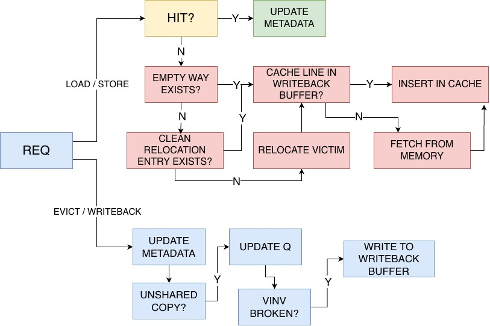
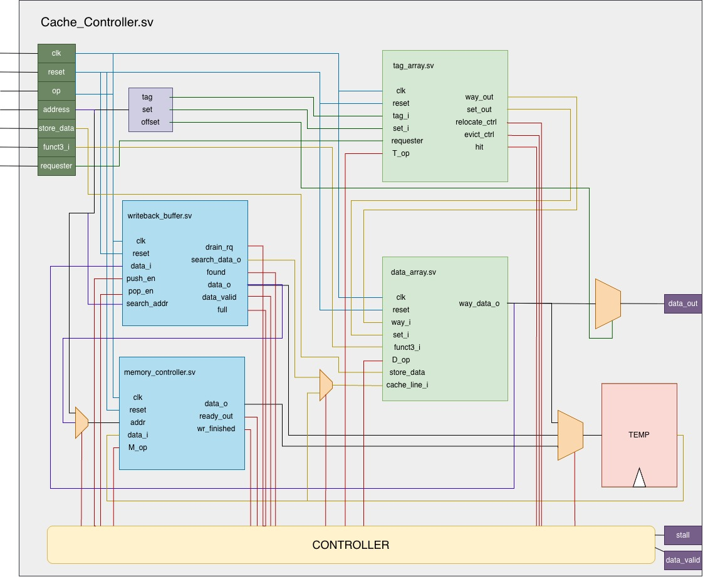
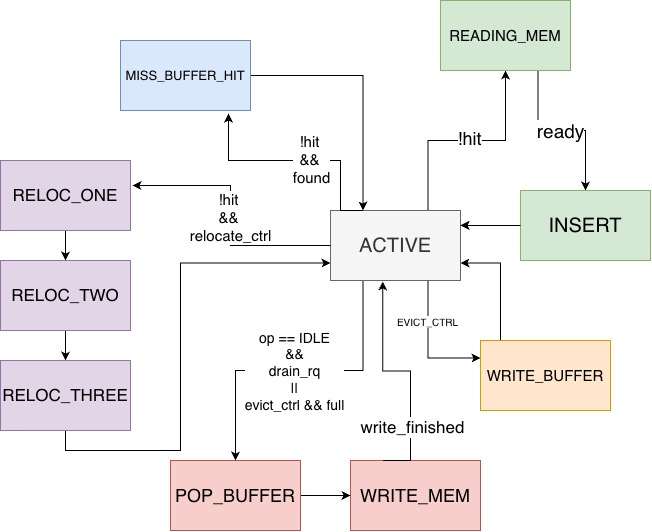

# ZeroCost-LLC

ZeroCost-LLC (ZCLLC) is a SystemVerilog implementation of a last-level cache based on the ACM paper “High Performance and Predictable Shared Last-Level Cache for Safety-Critical Systems” by Zhuanhao Wu, Anirudh Kaushik, and Hiren Patel (ACM Transactions on Embedded Computing Systems, 2024).

ZC-LLC is motivated by reducing timing penalties incurred by inclusion victims. In a multicore system with an inclusive last-level cache, all cache lines cached in the private caches of each core must also be cached in the last-level cache. If an incoming request requires the eviction of a privately cached line in the LLC, the LLC must first send a back-invalidation to the core caching that line before it can fulfill the request. This is known as an inclusion victim and causes unpredictable timing delays that are unsuitable for embedded applications with strict timing requirements.

This implementation of ZC-LLC uses both relocation and vacancy invariants (VINV) to reduce the timing penalty of inclusion victims to just three cycles. It achieves this by keeping track of all entries in the cache that can accommodate a new cache line without requiring any back-invalidations. These include vacant entries and cache lines that are not currently cached in any private cache. In cases where a set cannot accommodate a new cache line, a victim is selected and relocated to an available relocation entry. Its new location in the LLC is stored as a tuple in its Tag Array entry, allowing cores to continue accessing it. This ensures inclusivity is maintained while eliminating the need for back-invalidations. Since an inclusive LLC must have a capacity equal to or greater than the aggregate capacity of all private caches, a relocation entry is always guaranteed to exist. The VINV also ensures that a clean relocation entry is available at all times, reducing memory writebacks during relocations.

This implementation also introduces a Writeback Buffer to reduce the latency of eviction requests. The buffer drains opportunistically in the background while the cache is idle. The VINV can be modified to track Writeback Buffer capacity and drain when full to ensure that it can always accommodate an entry, reducing the need to track clean relocation entries.

For a more detailed explanation of the relocation process, refer to:

[Relocation Flow](docs/relocation_flow.md)

# Supported Features

- Parameterizable Set-Associative Cache
- Parameterizable Block Size, Memory Depth, and Memory Delay
- LRU Replacement Policy
- Load/Store Support
- Write-Back, Write-Allocate Cache
- Serial Tag Lookup and Data Access
- Writeback Buffer
- Relocation (ZIV)
- Vacancy Invariant (VINV)

# Planned Improvements

- Parameterizable Tag Lookup Width
- FIFO Request and Response Buffers
- Cache Banking
- UVM Testbench

# Overall Dataflow



# Architecture



The cache has four main modules.

## Tag Array

The Tag Array stores tags in a k-way set-associative array. For each way, it also stores the LRU ages and cache line states (empty, clean, relocated, shared). It performs tag comparisons and contains the LRU replacement logic. It also handles relocation.

For more information, please refer to:

## Data Array

The Data Array holds cache lines in a k-way set-associative array and returns the requested way.

For more information, please refer to:

## Memory Controller

Responsible for interfacing with main memory and handling reads and writes. Future expansions will allow the memory controller to be replaced with standard IP.

## Writeback Buffer

A FIFO buffer that holds evicted cache lines and opportunistically drains them to main memory.

For more information, please refer to:

For more detailed information on each module, refer to the following directory:

[Modules](docs/modules/)

# State Diagram



For more detailed information on each state, refer to:

[States](docs/states.md)

# Running the Cache

To run the simulation, ensure Verilator is installed and execute the following command:

```bash
make run
```

To view waveforms, ensure GTKWave is installed and execute:

```bash
make wave
```

All simulation outputs are stored in `sim/simout`.
