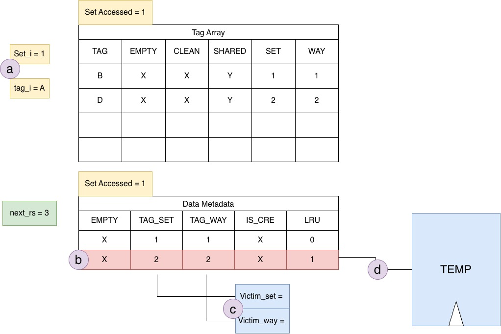
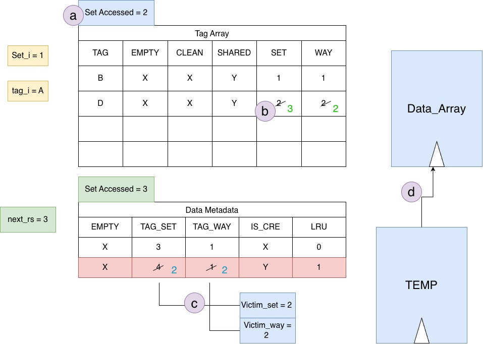
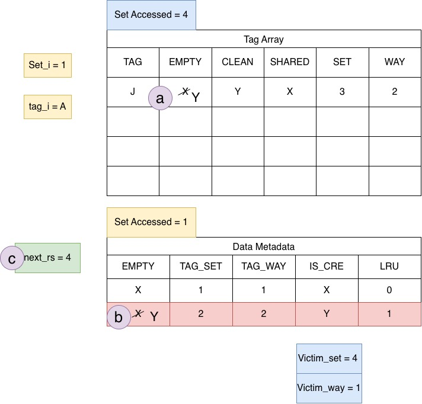

# Introduction  
Relocation is a core feature of ZCLLC, it allows cores in a multi-core system to share an inclusive last level cache without any back invalidations caused by inclusion victims. Unlike other solutions such as cache partionoing, relocation allows the entire cache to be shared for full resource utilisation with the added VINV inavariant checks ensuring a relocation entry is clean the worst case latency is on par with non inclusive caches. 

Relocation happens in three cycles, in the first cycle the victim is selected and its data is copied into temporary registers. In the next cycle the data is written to the relocation entry and the victims metadata is updated. In the third cycle any entries that need to be invalidated in the LLC are invalidated therby finishing the relocation process. The original data array will now have a vacant entry to accomadate an incoming request. 
Next_rs here is used to point to a set that contains a clean relocation entry.

# Cycle One 

A) Tag Miss, must be fetched and inserted into cache 
B) Data array, has no empty or clean relocation entries meaning evicting them from the cache would result in an inclusion victim. So Way 2 is selected as the victim and will be relocated elsewhere in the cache
C) The victim's location in the tag array is stored in temporary registers, this is needed to acess the metadata for the tag stored in this block, you may note this block has been relocated already
D) The victim's cache line is stored in a temporary register.  

# Cycle Two 

A) Victim's Tag set and way are acessed in this cycle for updating the metadata 
B) The Victim's Tag entry is modified to point to the new location in the data array where the data is now being stored
C) The next relocation set is accessed, there is one clean relocation entry, this entry is updated to point to the vicitm's tag array location. Its previous tag location is stored in order to invalidate that entry in the next cycle
D) The victim's stored data is written to the clean relocation entry in the data array 

# Cycle Three 

A) The previous tag location of the relocation entry is invalidated as the block now holds the victim's data 
B) The victim's orginal data array entry is invalidated as it is now in another location allowing a new cache line to be stored in this set. 
C) Next_rs is updated in round robin fashion to the next set that contains a clean relocation entry

# Vacancy Invariant (VINV) 
The vacancy invaraint ensures that when relocating the relocation entry is clean avoiding the need to write its contents to memory before completing the relocation. This is done using the following Invariant.
$$
M - |Q| \geq N \cdot T
$$
M is the LLC Capacity 
Q is the number of dirty cache lines not cached in any private cache
N is number of cores 
T is the private L2 Cache Capacity
On writeback or eviction requests from a core, ZCLLC checks if the cache line is now no longer cached in any private caches. If so it will check if the cache line is dirty or clean. If its dirty it will update Q and check the VINV. If VINV is broken the cache line is written to the writeback buffer and evicted from the cache, where it is then written to the main memory. 
