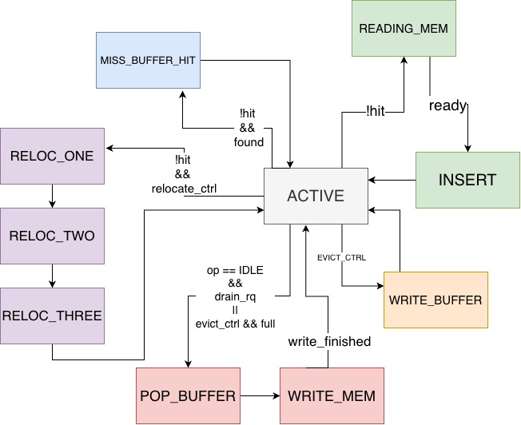

# Cache Controller FSM

The cache controller implements a finite state machine (FSM) responsible for coordinating operations between the Tag Array, Data Array, Writeback Buffer, and Main Memory.

The controller handles cache hits, cache misses, block relocation, writebacks, and memory accesses.

## ACTIVE

The default operating state of the cache. Tag comparisons are performed to determine whether the requested cache block is present.

### Idle Request

If the memory request is `C_IDLE`:

- The cache remains in `ACTIVE` if no writeback buffer drain is requested.
- If the writeback buffer asserts `drain_rq`, transition to `POP_BUFFER` to begin draining the buffer.

### Cache Hit

If a valid matching tag is found, the controller performs the requested operation:

- **C_LOAD:** Read the requested data from the Data Array, update tag metadata and LRU ages, and assert `data_valid`.
- **C_STORE:** Write the requested data into the Data Array and update tag metadata and LRU ages.
- **C_EVICT:** Update the sharer information and eviction metadata in the Tag Array.
- **C_WRITEBACK:** Update the cache line data and corresponding tag metadata.

If the Tag Array asserts `evict_ctrl`:

- If the Writeback Buffer is not full, transition to `WRITE_BUFFER`.
- If the Writeback Buffer is full, transition to `POP_BUFFER` to free an entry before buffering the eviction.

Otherwise, remain in `ACTIVE`.

### Cache Miss

If no matching tag is found:

- If `relocate_ctrl` is asserted during a load or store, transition to `RELOC_ONE`.
- Otherwise, if the requested address is found in the Writeback Buffer, transition to `MISS_BUFFER_HIT`.
- Otherwise, for a load or store request, transition to `READING_MEM`.
- For other operations, remain in `ACTIVE`.

The controller asserts `stall` when a load or store miss requires additional processing.

## READING_MEM

This state handles cache misses that require fetching data from Main Memory.

- Assert `stall` to prevent new cache operations.
- Set the memory controller operation to `M_READ`.
- Wait for the memory controller to assert `ready_out`.
- Once data is available, store the returned data in the temporary register `temp`.

**Transitions:**
- If `ready_out = 0`, remain in `READING_MEM`.
- If `ready_out = 1`, transition to `INSERT`.

## INSERT

This state inserts a newly fetched cache line into the cache.

- Assert `stall`.
- Set the Tag Array operation to `T_INSERT`.
- Set the Data Array operation to `D_WRITE`.
- Write the cache line stored in `temp` into the Data Array.
- Update the Tag Array and associated metadata to reflect the new cache line.

**Transition:** Unconditionally return to `ACTIVE`.

## MISS_BUFFER_HIT

This state handles a cache miss where the requested data is found in the Writeback Buffer.

Instead of accessing Main Memory, the controller retrieves the data directly from the buffer.

- Assert `stall`.
- Set the Tag Array operation to `T_INSERT`.
- Set the Data Array operation to `D_WRITE`.
- Write `search_data_o` from the Writeback Buffer into the Data Array.
- Assert both `push_en` and `pop_en` to trigger the buffer's simultaneous-operation logic, which is intended to invalidate the matching entry.

**Transition:** Unconditionally return to `ACTIVE`.

## RELOC_ONE

The first stage of cache block relocation.

This state is entered when a cache miss occurs and the Tag Array indicates that relocation is required.

- Assert `stall`.
- Set the Tag Array operation to `T_RELOC_ONE`.
- Set the Data Array operation to `D_READ`.
- Select the LRU victim in the target data set.
- Save the victim's associated tag location.
- Store the victim's cache line data in the temporary register `temp`.

**Transition:** Unconditionally transition to `RELOC_TWO`.

## RELOC_TWO

The second stage of cache block relocation.

The selected victim is relocated to an available entry in another data set.

- Assert `stall`.
- Set the Tag Array operation to `T_RELOC_TWO`.
- Set the Data Array operation to `D_WRITE`.
- Write the victim's cache line from `temp` into the selected relocation entry.
- Update the victim's tag pointer to reference its new data location.
- Update the reverse pointer in the destination Data Array metadata.
- Track whether the destination entry previously contained a valid block that must be invalidated.

**Transition:** Unconditionally transition to `RELOC_THREE`.

## RELOC_THREE

The final stage of cache block relocation.

This state completes the relocation process and prepares the cache to service the original miss.

- Assert `stall`.
- Set the Tag Array operation to `T_RELOC_THREE`.
- Invalidate the victim's original data entry.
- Mark the original data location as available for future insertions.
- If the relocation overwrote an existing entry, invalidate its corresponding tag.

**Transitions:**
- If the requested address is found in the Writeback Buffer, transition to `MISS_BUFFER_HIT`.
- Otherwise, transition to `READING_MEM` to fetch the requested cache line.

For a more detailed explanation, see [Relocation Flow](relocation_flow.md).

## WRITE_BUFFER

This state handles cache block eviction by inserting the evicted data into the Writeback Buffer.

- Set the Tag Array operation to `T_REMOVE`.
- Assert `push_en` to insert a new entry into the Writeback Buffer.
- Construct the buffer entry using the requested address and selected cache line data.
- Remove the corresponding entry from the Tag Array and invalidate its Data Array entry.
- Deassert `stall`.

**Transition:** Unconditionally return to `ACTIVE`.

## POP_BUFFER

This state removes the oldest pending writeback entry from the Writeback Buffer.

- Assert `stall`.
- Assert `pop_en` to remove the oldest entry from the FIFO.
- Capture the popped address and data for the subsequent memory write operation.

The controller uses the buffer output to update:
- `mem_addr`: Address of the pending writeback.
- `temp`: Data to be written to Main Memory.

**Transition:** Unconditionally transition to `WRITE_MEM`.

## WRITE_MEM

This state writes a previously popped Writeback Buffer entry to Main Memory.

- Assert `stall`.
- Set the memory controller operation to `M_WRITE`.
- Supply the writeback address through `mem_addr`.
- Supply the writeback data through `mem_data_in` using the temporary register `temp`.
- Wait for the memory controller to assert `wr_finished`.

If `buff_write` is asserted, indicating that a pending cache eviction needs buffer space:

- Assert `push_en` to insert the pending eviction into the Writeback Buffer.
- Set the Tag Array operation to `T_REMOVE`.
- Clear `buff_write` on the next clock edge.

**Transitions:**
- If `wr_finished = 0`, remain in `WRITE_MEM`.
- If `wr_finished = 1`, transition to `ACTIVE`.
